  

  
  
  

 

 

<h3 align="center">Stack</h3>

 

<h3 align="center">Contributions</h3>

<picture>
  <source media="(prefers-color-scheme: dark)" srcset="https://raw.githubusercontent.com/AlirezaTalezadeh/AlirezaTalezadeh/output/snake-dark.svg" />
  <source media="(prefers-color-scheme: light)" srcset="https://raw.githubusercontent.com/AlirezaTalezadeh/AlirezaTalezadeh/output/snake-light.svg" />
  
</picture>

  

